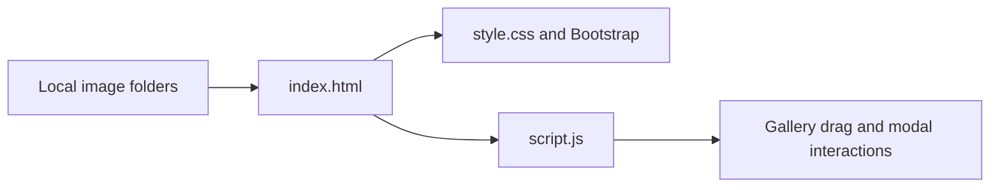

# VTEC Website

A static website presenting the VIT-AP Technology Entrepreneurship Centre, with introductory content, an image gallery, and contact-page elements.

## Purpose

The project brings a centre's overview, vision, mission, and visual content into one page. It is a practical frontend exercise in responsive layout, navigation, carousels, and image interactions.

## Included features

- Bootstrap navigation and hero carousel.
- Vision, mission, and about sections.
- A horizontally draggable image gallery with arrow controls.
- An image modal that opens the selected gallery image.
- Contact-form markup and a collection of local image assets.

## View locally

Download and extract the repository, then open [index.html](index.html) in a browser. No package installation or build step is required.

Alternatively, from the repository root with Python 3 installed:

```bash
python3 -m http.server 8000
```

Open `http://localhost:8000`. Bootstrap and Font Awesome are loaded from external CDNs, so their styles and behavior require a network connection unless vendored separately.

## How it is organized



| Path | Purpose |
| --- | --- |
| [index.html](index.html) | Content and page structure |
| [script.js](script.js) | Gallery and modal interactions |
| [Images](Images) | Branding and campus imagery |
| [assest](assest) | Additional gallery assets |

## Customization and scope

Update the page content in HTML, visual styling in CSS, and gallery behavior in JavaScript. The contact form uses `action="#"`; no message delivery backend is included. Institutional descriptions and historical details are stored page content and should be checked with the centre before republishing them as current information.

This repository presents VTEC-related content; it does not establish an official affiliation or a live institutional deployment.
